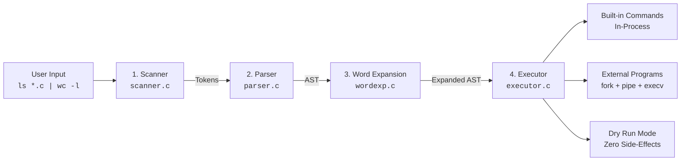

<!-- Logo Section — auto-switches between light and dark mode -->
<p align="center">
  <picture>
    <source media="(prefers-color-scheme: dark)" srcset="assets/logo-dark.png" />
    <source media="(prefers-color-scheme: light)" srcset="assets/logo-white.png" />
    
  </picture>
</p>

<p align="center">
  <strong>A dependency-free Unix shell built entirely from scratch in C.</strong><br/>
  <sub>Tokenizer · Parser · AST · Executor — every layer handcrafted with POSIX system calls.</sub>
</p>

<p align="center">
  <a href="https://github.com/NaimurRahmannn/Mshx-shell-Linux-os/blob/main/LICENSE"></a>
  <a href="https://github.com/NaimurRahmannn/Mshx-shell-Linux-os"></a>
  <a href="https://github.com/NaimurRahmannn/Mshx-shell-Linux-os"></a>
  <a href="https://github.com/NaimurRahmannn/Mshx-shell-Linux-os/commits/main"></a>
  <a href="https://github.com/NaimurRahmannn/Mshx-shell-Linux-os/stargazers"></a>
</p>

<p align="center">
  <a href="#quick-install">Install</a>&nbsp;&nbsp;·&nbsp;&nbsp;
  <a href="#how-it-works">Architecture</a>&nbsp;&nbsp;·&nbsp;&nbsp;
  <a href="#built-in-commands">Built-ins</a>&nbsp;&nbsp;·&nbsp;&nbsp;
  <a href="#what-you-can-do">Examples</a>&nbsp;&nbsp;·&nbsp;&nbsp;
  <a href="#contributing">Contributing</a>
</p>

---

**MshX** is a lightweight, dependency-free Unix command shell built entirely from scratch in C99. Designed without readline, ncurses, or any third-party libraries, MshX implements every subsystem by hand using raw POSIX system calls — featuring a complete compiler-style architecture with a lexical scanner, recursive-descent parser producing an Abstract Syntax Tree (AST), a six-phase word expansion engine, and an execution pipeline.

Beyond standard POSIX capabilities like multi-stage pipelines, I/O redirection, background process management, and shunting-yard arithmetic evaluation, MshX includes developer-focused features: a **`dry` run mode** that previews execution plans with zero side effects, and an integrated **`timeline` profiler** that traces process lifecycle events with millisecond precision.

```text
~_~:$ ls *.c | wc -l
20

~_~:$ dry ls *.c | wc -l
GLOB: *.c -> executor.c initsh.c main.c node.c parser.c pattern.c prompt.c scanner.c shunt.c source.c strings.c wordexp.c
PIPE: ls -> wc
EXEC: /usr/bin/ls executor.c initsh.c main.c node.c parser.c pattern.c prompt.c scanner.c shunt.c source.c strings.c wordexp.c
EXEC: /usr/bin/wc -l

~_~:$ echo "Arithmetic: $(( (15 * 4) / (2 + 1) ))"
Arithmetic: 20
```

<!-- ─────────────────────────────────────────────────────────── -->

## Quick Install

**One command. That's it.**

```bash
curl -sSL https://raw.githubusercontent.com/NaimurRahmannn/Mshx-shell-Linux-os/main/install.sh | bash
```

<details>
<summary><strong>Manual build from source</strong></summary>

<br/>

```bash
git clone https://github.com/NaimurRahmannn/Mshx-shell-Linux-os.git
cd Mshx-shell-Linux-os
make
./mshX
```

**System install:**
```bash
make install                         # → ~/.local/bin/mshx
sudo make install PREFIX=/usr/local  # → /usr/local/bin/mshx
make uninstall                       # remove it
```

**Requirements:** GCC (C99), GNU Make, Linux/POSIX

</details>

---

## Why MshX?

Most "build a shell" tutorials stop at `fork` + `exec` with a `|` pipe. **MshX goes far beyond that.**

<table>
<tr>
<td width="50%">

### What's Inside

- Full **lexical analyzer** that handles quotes, escapes, and 10+ operator types
- **Recursive-descent parser** producing a proper Abstract Syntax Tree
- **Six-stage word expansion** pipeline (tilde → vars → commands → arithmetic → field split → globs)
- **Shunting-yard algorithm** for arithmetic with all C integer operators
- **Scoped symbol table** with a stack-based scope chain

</td>
<td width="50%">

### What Makes It Different

- **`dry` command** — preview the entire execution plan with zero side effects
- **`timeline` profiler** — trace `fork`/`exec`/`exit` events with ms timestamps
- **Zero dependencies** — no readline, no ncurses, nothing external
- **Dual execution engine** — same AST drives both real and dry-run modes
- **6,800+ lines** of pure, handcrafted C

</td>
</tr>
</table>

---

## How It Works

Every command passes through a **compiler-style pipeline** before anything executes:



<details>
<summary><strong>Detailed stage breakdown</strong></summary>

<br/>

### Stage 1 — Scanner (`scanner.c`)

Reads the raw character stream and produces tokens. Handles:
- Quoted strings (`"..."`, `'...'`, `` `...` ``)
- Escape sequences (`\`)
- All operators: `|`, `||`, `&&`, `;`, `&`, `>`, `>>`, `<`
- Variable references (`$VAR`, `${...}`, `$(...)`)
- Dynamic buffer that starts at 1KB and doubles as needed

### Stage 2 — Parser (`parser.c`)

Recursive-descent parser that builds an AST. Each command becomes a `NODE_COMMAND` node with `NODE_VAR` children for each argument. The parser stops at operator boundaries and returns control to the main loop for pipeline/logical operator handling.

### Stage 3 — Word Expansion (`wordexp.c` — 1,800+ lines)

Every word goes through six expansion phases in order:

| Phase | Example | Result |
|---|---|---|
| **Tilde** | `~/docs` | `/home/user/docs` |
| **Variable** | `${HOME:-/tmp}` | `/home/user` |
| **Command** | `` `whoami` `` | `user` |
| **Arithmetic** | `$((2+3*4))` | `14` |
| **Field Split** | (split on `$IFS`) | separate words |
| **Pathname** | `*.c` | `main.c parser.c ...` |

### Stage 4 — Executor (`executor.c`)

Dispatches commands through two paths:
- **Built-ins** → run in the shell process (no fork)
- **External** → `fork()` + `execv()` with pipeline wiring via `pipe()` + `dup2()`

A single `enum exec_mode` flag switches the entire executor between **real** and **dry-run** modes — same AST, different behavior.

</details>

---

## Built-in Commands

<details open>
<summary><strong><code>dry</code></strong> — Zero-side-effect execution preview</summary>

<br/>

The flagship feature. Runs the *entire* parsing and expansion pipeline — but stops before any system call with side effects. No `fork()`, no `exec()`, no file I/O.

```bash
~_~:$ dry cat input.txt > output.txt
EXEC: /usr/bin/cat input.txt
REDIRECT: stdout -> output.txt
```

```bash
~_~:$ dry echo *.c | sort | head -5
PIPE: echo -> sort
PIPE: sort -> head
GLOB: *.c -> executor.c initsh.c main.c node.c parser.c ...
EXEC: /usr/bin/echo executor.c initsh.c main.c ...
EXEC: /usr/bin/sort
EXEC: /usr/bin/head -5
```

</details>

<details>
<summary><strong><code>timeline</code></strong> — Process lifecycle profiler</summary>

<br/>

Prefix any command with `timeline` to trace kernel-level events with millisecond precision:

```bash
~_~:$ timeline ls | grep .c
executor.c
main.c
...

PID    EVENT                TIME(ms)
------ -------------------- --------
18201  forked               0
18201  execve               0
18202  forked               0
18202  piped(18201→18202)   0
18202  execve               0
18201  exited(0)            1
18202  exited(0)            1
```

**Tracked events:** `forked` · `execve` · `exited(code)` · `signaled(sig)` · `stopped(sig)` · `continued` · `piped(A→B)` · `redirected(>file)`

Uses `clock_gettime(CLOCK_MONOTONIC)` for timing and stores up to 256 events.

</details>

<details>
<summary><strong><code>history</code></strong> — Command history with expansion</summary>

<br/>

1,000-entry circular buffer with automatic deduplication of consecutive identical commands.

```bash
history         # show all entries
history 20      # show last 20
history -c      # clear everything
```

**Inline expansion** — works anywhere in your command:

```bash
!!              # repeat last command
!5              # repeat command #5
!-2             # repeat 2 commands ago
```

</details>

<details>
<summary><strong><code>cd</code></strong> — Directory navigation</summary>

<br/>

```bash
cd              # → $HOME
cd /tmp         # → /tmp
cd -            # → previous directory ($OLDPWD)
```

Automatically tracks `PWD` and `OLDPWD` in the symbol table.

</details>

<details>
<summary><strong><code>dump</code></strong> — Symbol table inspector</summary>

<br/>

Print every variable in the current scope:

```bash
~_~:$ dump
Symbol table [Level 0]:
===========================
  No               Symbol                    Val
------ -------------------------------- ------------
[0000] HOME                             '/home/user'
[0001] PATH                             '/usr/local/bin:/usr/bin:/bin'
[0002] PS1                              '$ '
...
```

</details>

---

## What You Can Do

```bash
# Pipelines — up to 64 stages
cat /var/log/syslog | grep error | sort | uniq -c | sort -rn | head

# I/O Redirection
sort < input.txt > sorted.txt
echo "appended" >> log.txt

# Logical operators (short-circuit)
mkdir build && cd build
gcc main.c || echo "failed"

# Background jobs
find / -name "*.log" > results.txt &

# Variables & parameter expansion
echo $HOME $? $$
echo ${HOME:-/tmp}
echo ${#PATH}

# Arithmetic
echo $((10 + 20 * 3))
echo $(( (5 > 3) ? 100 : 0 ))

# Globbing
ls *.c
cat [Mm]akefile

# Command sequences
echo one ; echo two ; echo three

# Multi-line
echo "continues \
on the next line"
```

---

## Project Structure

```
MshX/
│
├── main.c              REPL loop — read, expand history, parse, execute
├── scanner.c           Lexical analyzer (quotes, escapes, 10+ operators)
├── parser.c            Recursive-descent parser → AST
├── node.c              AST node creation and memory management
├── executor.c          fork/exec/pipe/redirect/background engine
├── wordexp.c           Six-stage word expansion pipeline (1,800+ lines)
├── shunt.c             Shunting-yard arithmetic evaluator (1,300+ lines)
├── pattern.c           Glob pattern matching via fnmatch()
├── source.c            Character-stream abstraction (next/peek/unget)
├── prompt.c            Prompt rendering with ~ substitution
├── initsh.c            Environment import & signal setup
├── strings.c           Buffer management & string utilities
│
├── builtins/
│   ├── builtins.c      Dispatch table for built-in commands
│   ├── cd.c            cd with OLDPWD tracking
│   ├── dry.c           Dry-run execution mode
│   ├── dump.c          Symbol table inspector
│   ├── history.c       Circular buffer history with expansion
│   └── timeline.c      Process lifecycle profiler
│
├── symtab/
│   └── symtab.c        Scoped linked-list symbol table with stack
│
├── assets/             Logo images
├── install.sh          One-liner installer script
├── Makefile            Build system with install/uninstall targets
└── LICENSE             MIT License
```

<p align="center">
  <strong>20 source files&nbsp;&nbsp;·&nbsp;&nbsp;6,800+ lines of C&nbsp;&nbsp;·&nbsp;&nbsp;Zero external dependencies</strong>
</p>

---

## Signal Handling

| Signal | Shell Behavior | Child Behavior |
|---|---|---|
| `SIGINT` (Ctrl+C) | Ignored — prints a newline | Default — terminates the process |
| `SIGTSTP` (Ctrl+Z) | Ignored | Default — suspends the process |
| `SIGTTOU` | Ignored globally | Inherited |

Child processes get default handlers restored via `signal(SIG*, SIG_DFL)` immediately after `fork()`. Background jobs are isolated with `setpgid(0, 0)`.

---

## Contributing

Contributions are welcome. Here's how:

```bash
# 1. Fork & clone
git clone https://github.com/<your-username>/Mshx-shell-Linux-os.git
cd Mshx-shell-Linux-os

# 2. Create a branch
git checkout -b feature/my-feature

# 3. Make changes & test
make clean && make
./mshX

# 4. Commit & push
git commit -m "feat: add my feature"
git push origin feature/my-feature

# 5. Open a Pull Request
```

Please ensure your code compiles cleanly with `-Wall -Wextra`.

---

## License

MIT License — see [LICENSE](LICENSE) for the full text.

Copyright © 2026 [NaimurRahmannn](https://github.com/NaimurRahmannn)

---

<p align="center">
  <sub>If you find this project useful or interesting, consider starring the repository.</sub>
</p>
